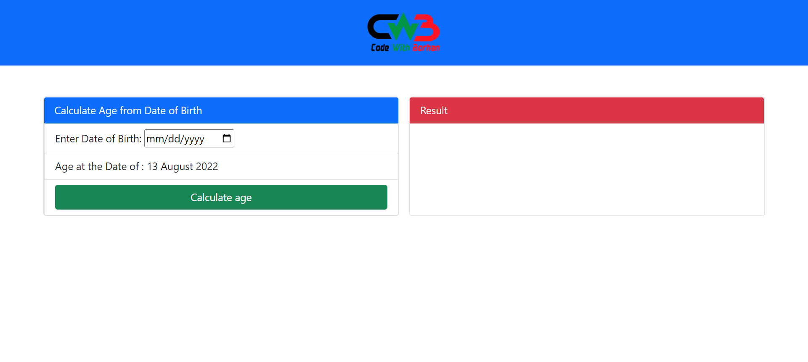

# Multi-Calculator Web App (React + Vite)

A modern, responsive multi-calculator suite built with **React 18**, **Vite**, **Bootstrap 5**, **ECharts**, and **html2canvas**.

<p align="center">
  
</p>

---

## 🧮 Available Calculators

### 1. 🖩 Standard Calculator (`#/`)

- **Neumorphic Interface**: Tactile 3D soft-shadow design inspired by classic electronic calculators.
- **Full Arithmetic Operations**: Addition (`+`), subtraction (`-`), multiplication (`*`), division (`/`), and square root (`√`).
- **Equation History**: Shows live expression history and accurate results.
- **Keyboard Support**: Full physical keyboard shortcuts (numbers, operators, `Enter` to solve, `Backspace`, and `Escape`/`C` to clear).

### 2. 📅 Age Calculator (`#/age`)

- **3-Part Date Picker**: Independent Day dropdown (1–31), Month selector (Jan–Dec), and numeric Year input.
- **Smart Validation**: Dynamic day validation per month, leap year detection, and future date checks.
- **Comprehensive Time Breakdown**:
  - Primary age in years, months, and days
  - Total months + remaining days
  - Total weeks + remaining days
  - Total days, hours, minutes, and seconds
- **Utilities**: One-click **Copy Result** and **Reset** buttons. Defaults to yesterday's date.

### 3. ⚖️ BMI Calculator (`#/bmi`)

- **Inputs**: Height in Feet.Inches (e.g. `5.8`) and Weight in KG (e.g. `68`).
- **Interactive Gauge Chart**: Visual ECharts gauge meter with color-coded BMI zones.
- **Dynamic Character Avatars**: Visual body illustrations corresponding to Underweight, Healthy, Overweight, Obese, or Extra Obese.
- **Threshold Reference**: Summary badges and health status guidelines.

### 4. 🎓 Grade Calculator (`#/grade`)

- **Official Board Result Format**: Modeled directly after the Bangladesh Intermediate and Secondary Education Boards result sheet (`educationboardresults.gov.bd`).
- **Examination & Student Metadata**: Custom examination type (SSC/HSC/JSC/DIBS), passing year, board, group, roll number, and student details.
- **Mark-Based Automatic Grading**: Enter subject marks (`0–100`); grades (`A+`, `A`, `A-`, `B`, `C`, `D`, `F`) and grade points are calculated automatically.
- **4th / Optional Subject Bonus**: Correctly calculates optional subject points (points above `2.0` added to GPA).
- **Result Export & Downloads**:
  - **Download Image (PNG)**: High-resolution (Retina 2x) image download via `html2canvas`.
  - **Print / Save PDF**: Dedicated `@media print` layout tailored for clean A4 printing without UI clutter.
- **Responsive Layout**: Side-by-side on desktop, clean segmented view switch on mobile.

### 5. 💖 Love Calculator (`#/love`)

- **Compatibility by Names**: Calculates romantic compatibility percentage based on partner names.
- **Animated Experience**: Floating hearts, animated score counter, and compatibility status titles (`True Soulmates`, `Strong Match`, `Great Chemistry`).
- **Export & Share**:
  - **Download Result Image (PNG)**: Generates a high-resolution shareable love certificate card.
  - **Native Share & Clipboard Copy**: Share directly on mobile or copy the result message with one tap.

---

## 🧭 Navigation & Architecture

- **Sliding Indicator Navbar**: Smooth curved `.hori-selector` animated indicator tracking active routes in real-time.
- **Hash Routing (`HashRouter`)**: Uses `react-router-dom` with hash-based routes (`#/`, `#/age`, `#/bmi`, `#/grade`, `#/love`) for zero-configuration compatibility with static hosts (GitHub Pages, Netlify, Vercel).
- **Automated Deployment**: Preconfigured GitHub Actions workflow (`.github/workflows/deploy.yml`) that builds Vite and deploys production bundles automatically on push.

---

## 🛠️ Tech Stack

- **Framework**: [React 18](https://react.dev/)
- **Build Tool**: [Vite 5](https://vitejs.dev/)
- **Routing**: [React Router DOM 7](https://reactrouter.com/)
- **Styling**: [Bootstrap 5](https://getbootstrap.com/), Font Awesome 5, Custom CSS
- **Data Visualization**: [Apache ECharts](https://echarts.apache.org/)
- **Image Generation**: [html2canvas](https://html2canvas.hertzen.com/)

---

## 🚀 Getting Started

### Prerequisites

- [Node.js](https://nodejs.org/) (v18 or higher recommended)
- `npm`

### Installation

```bash
# Clone the repository
git clone https://github.com/wapborhan/calculators.git
cd calculators

# Install dependencies
npm install
```

### Running Locally

```bash
# Start development server
npm run dev
```

Open `http://localhost:5173` in your browser.

### Building for Production

```bash
# Build production bundle into /dist
npm run build

# Preview production build locally
npm run preview
```

---

## 📄 License

This project is open-source and available under the [MIT License](LICENSE).
